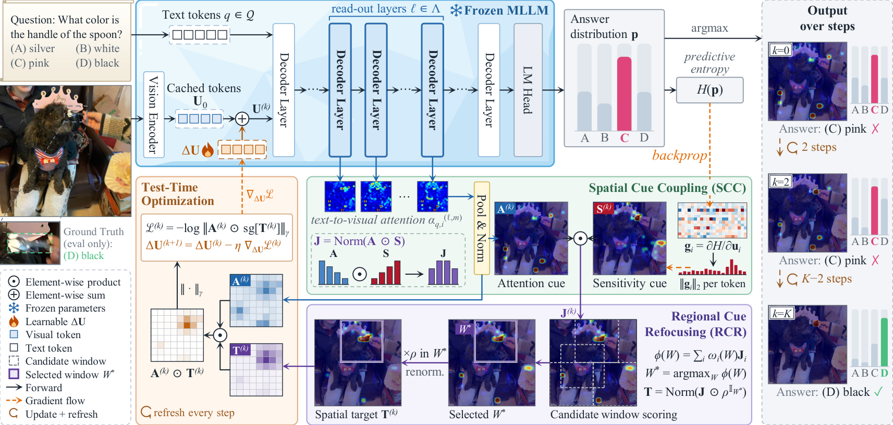
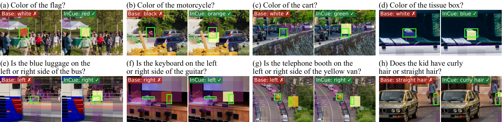

# InCue: Making Better Use of What Multimodal LLMs Already See at Test Time

Shuwei Wu1 &emsp; Siyue Yu2 &emsp; Longin Jan Latecki1

1Temple University &emsp; 2Xi'an Jiaotong-Liverpool University

  

<b>Overview of InCue.</b> The MLLM stays frozen, and the only free variable is an additive offset Δ<i>U</i> on the cached visual tokens <i>U</i>0. SCC couples the read-out attention cue <i>A</i> with the sensitivity cue <i>S</i>, obtained by backpropagating the predictive entropy <i>H</i>(<i>p</i>), into the joint response <i>J</i>. RCR amplifies <i>J</i> inside the best-scoring window <i>W</i>⋆ to form the spatial target <i>T</i>. Test-time optimization then updates Δ<i>U</i> to increase the overlap between the current attention <i>A</i>(<i>k</i>) and <i>T</i>(<i>k</i>). The cues and the target are refreshed at every step <i>k</i>, and the answer is read out after <i>K</i> steps (Output): here it changes from (C) pink to the correct (D) black.

## Abstract

Even when multimodal large language models (MLLMs) answer incorrectly, their internal cues often point to the relevant region.
A widely used remedy re-presents the cue-selected region as an enlarged crop to supply finer detail.
However, we find that much of its gain requires no new detail: it largely survives when the crop comes from the already-seen low-resolution input, and partly even when the region's cached tokens are merely copied.
Part of re-presentation's gain thus comes from drawing attention to evidence the model already holds.
We propose **InCue**, a test-time framework that makes better use of this evidence without additional visual input.
InCue treats visual attention and predictive-entropy gradients as **In**ternal **Cue**s, couples them into a spatial target, and optimizes only an offset on the existing visual tokens to steer attention toward it.
Under matched visual-token budgets, InCue achieves state-of-the-art performance, consistently outperforming recent test-time methods and improving four MLLMs by up to 8.9% on V* and 23.4% on its hard samples.
Its gains carry over to eight general benchmarks.

## Examples

  

<b>Examples corrected by InCue.</b> Eight V* questions that Qwen2.5-VL-7B answers wrongly, shown before (left) and after (right) six InCue steps. Heat maps show attention over visual tokens, green boxes the ground-truth targets, and top-left labels the predictions (green correct, red wrong). InCue moves the attention onto the queried object and corrects the answer.

## Code

The code will be released in December 2026.
